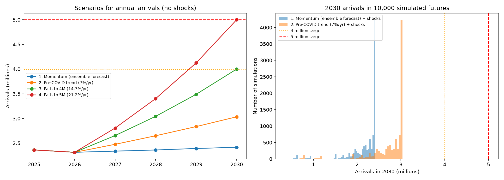
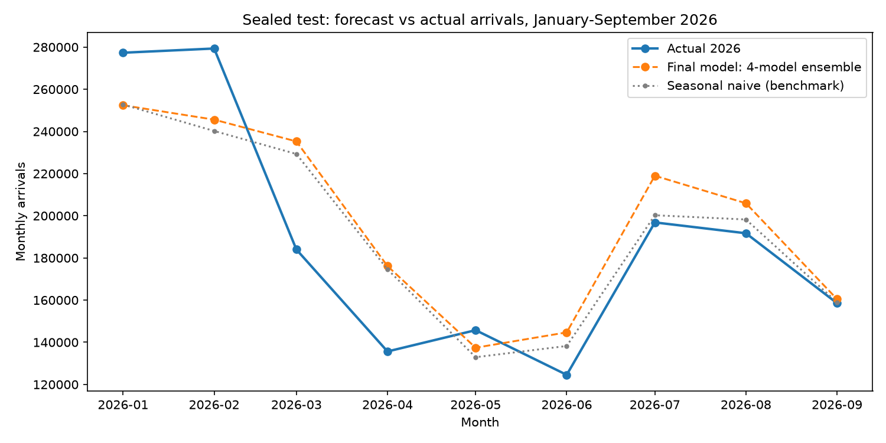
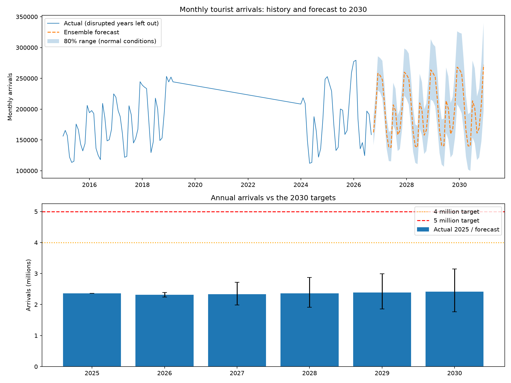

# Five Million by 2030? Forecasting Sri Lanka's Tourism Demand

Can Sri Lanka reach its target of **5 million tourists a year by 2030** (or the alternative 4 million)?
This project builds a 55-year monthly dataset from official SLTDA reports, compares classical
statistical models with modern pre-trained neural forecasting models, tests the best one on sealed
2026 data, and forecasts to 2030 with shock scenarios.

## Key findings
- **Under current momentum, Sri Lanka reaches about 2.4 million arrivals in 2030** (80% range 1.8-3.2M).
- **4 million needs 14.7% growth every year from 2026; 5 million needs 21.2%.** Sri Lanka has only
  grown this fast when rebounding from a crisis.
- Even a return to the **pre-COVID growth trend (7% a year) reaches about 3.0 million**.
- Shocks are frequent: arrivals fell more than 10% in **11 of the last 54 years**. Including that risk,
  there is a **55% chance 2030 ends below the 2025 level** under current momentum.



## Data
- Monthly foreign arrivals, **January 1971 to September 2026** (669 months), from SLTDA Annual
  Statistical Reports, Year in Review reports and weekly reports. See `data/README.md` for sources,
  definitions and known issues.
- Every processed file can be rebuilt from the PDFs with the scripts in `data/extraction/`.

## Method
1. **Exploration** (`02_explore.py`, `03_decompose.py`): log scale, seasonality before and after COVID,
   growth needed for the targets, STL decomposition.
2. **Models**, all in `tourism/models.py` with the same interface `model(train, horizon)`:

   | Model | Type |
   |---|---|
   | Seasonal naive | benchmark ("same as last year") |
   | Regression | log-linear trend + month dummies + post-COVID level |
   | Holt-Winters (damped) | exponential smoothing |
   | SARIMA (0,1,1)(1,1,1,12) | chosen by AIC from 16 candidates |
   | **Chronos-2** (Amazon) | pre-trained transformer foundation model, zero-shot |
   | **TimesFM 2.5** (Google) | pre-trained transformer foundation model, zero-shot |
   | **Ensemble** | average of Holt-Winters, SARIMA, Chronos-2 and TimesFM |

3. **Backtest** (`08_backtest.py`): train on the past, forecast the next 12 months, for 2014-2018 and 2025.
4. **Sealed test** (`09_test_2026.py`): the final model was fixed *before* the January-September 2026
   data was opened.
5. **Forecast and scenarios** (`10_forecast_2030.py`, `11_scenarios.py`): forecast to December 2030
   with an 80% range, four growth scenarios, and a 10,000-run Monte Carlo of historical shocks.

## Results

### Model comparison (backtest, MAPE)
| Model | Average error |
|---|---|
| **Ensemble (HW + SARIMA + Chronos-2 + TimesFM)** | **7.7%** |
| Holt-Winters damped | 8.0% |
| Chronos-2 | 8.2% |
| SARIMA / TimesFM 2.5 | 8.4% |
| Seasonal naive | 11.7% |
| Regression | 13.9% |

Combining models helps because they make different mistakes in different years.

### Sealed test (January-September 2026)
- Final model: **13.4%** error (seasonal naive: 11.3%); the backtest had suggested 7.7%.
- Arrivals fell 20-30% in **March-April 2026 when the Middle East war disrupted air transit routes**.
  No model can foresee such events from past arrival numbers. Excluding those months, error was ~10%.
- **Lesson:** in normal years the ensemble beats simple methods, but sudden shocks dominate forecast
  error. That is why the 2030 outlook includes shock scenarios.



### Forecast to 2030


## Modeling decisions
- **Training window: January 2010 - latest month.** 1971-2009 reflects a much smaller, war-affected industry.
- **April 2019 - December 2023 treated as missing** (Easter attacks, COVID-19 airport closure, 2022
  economic crisis, and recovery: 2023 arrivals were still 43-83% of 2018 levels).
- **Disrupted months are handled per model:** regression drops them, SARIMA and Chronos-2 skip them
  natively, Holt-Winters and TimesFM join 2010-2018 directly to 2024+.
- **2010 vs 2013 start** was tested in the backtest: it changed only the regression (which the early
  post-war boom made too optimistic), not the final model.
- **2026 shock months are kept** in the final forecast, as they are part of the current situation.

## Limitations
- Forecasts use past arrivals only; they cannot see policy changes (e.g. visa-free entry), new air
  routes or marketing campaigns, which could raise growth above the momentum forecast.
- The 80% range covers normal variation only; the shock simulation adds downside risk but no upside surprises.
- The shock model assumes shocks occur at the historical rate (20% per year) and that half of the
  lost ground is recovered each year.
- Pre-trained models may have seen similar public data during training; the 2026 test is the only fully clean test.

## How to run
```bash
uv pip install -r requirements.txt
python run_all.py          # about 6-8 minutes; first run downloads Chronos-2 and TimesFM
```
Outputs: figures in `figures/`, tables in `results/`.

## Project structure
```
data/          raw SLTDA PDFs (not committed), processed CSVs, extraction scripts
tourism/       reusable package: paths, data loading, metrics, models
scripts/       01-11, one script per step
figures/       all charts
results/       all result tables
run_all.py     runs everything in order
```